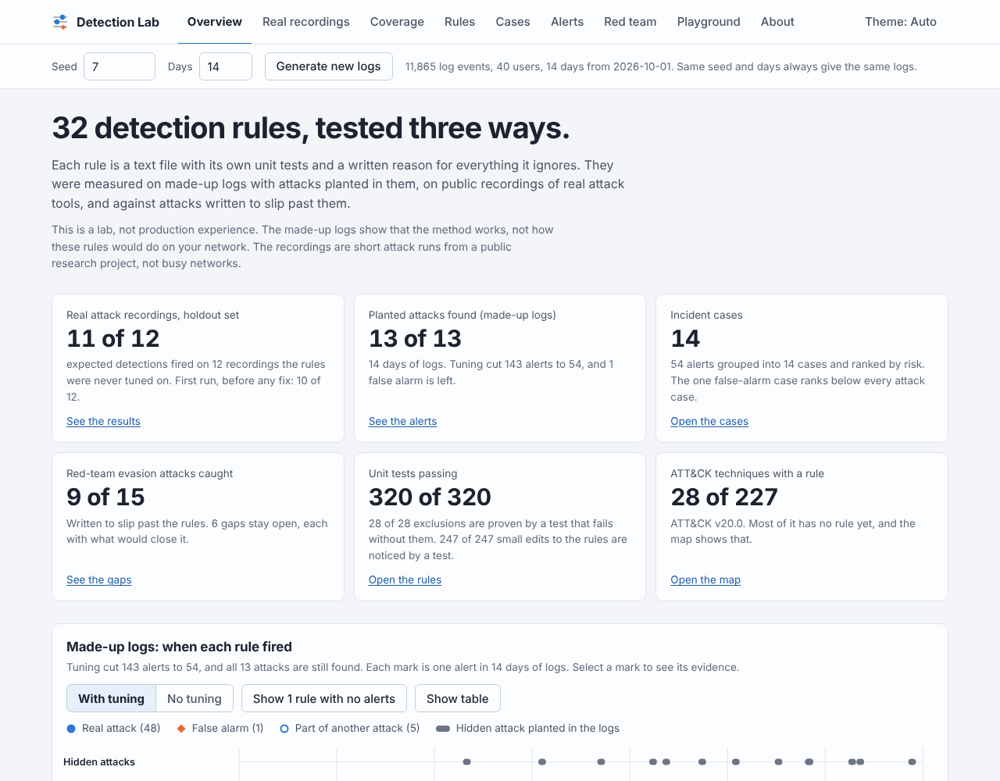
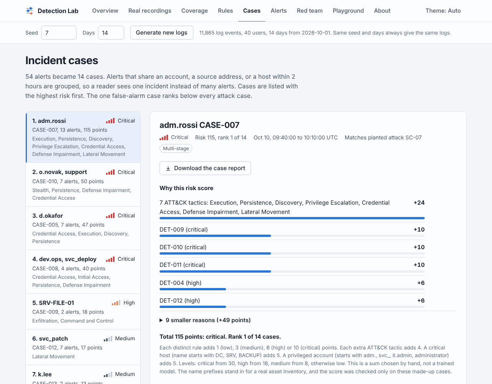
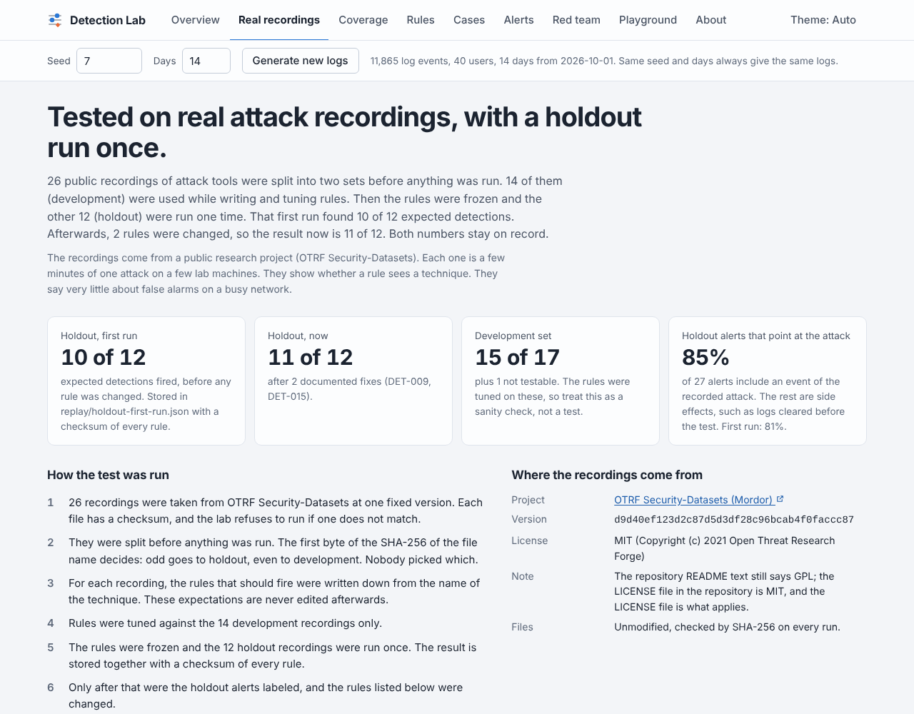
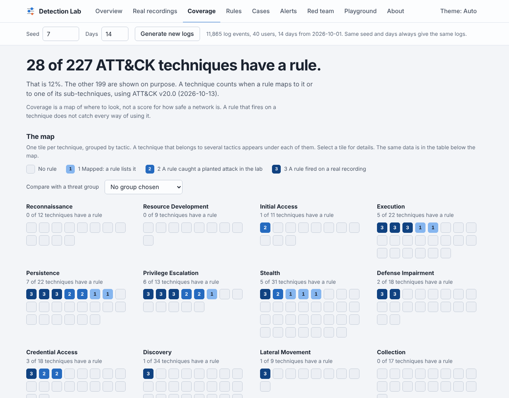
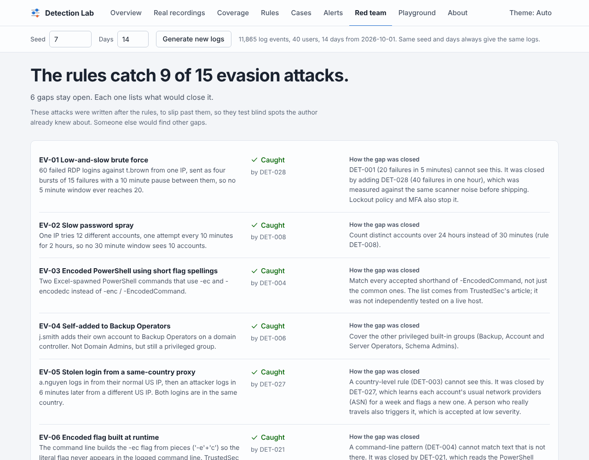
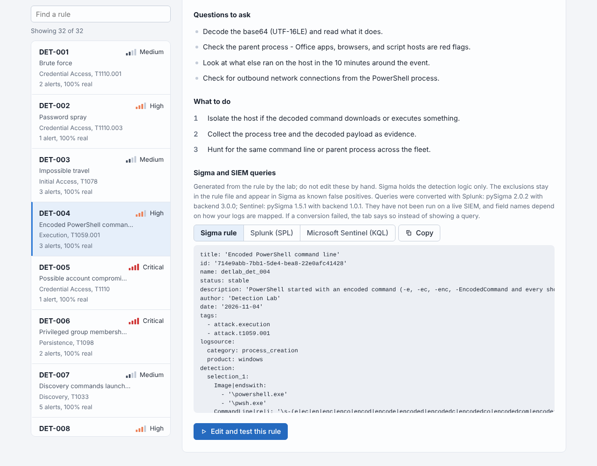

# detlab - a detection-engineering lab

32 detection rules written as code, and the evidence for how far to trust them.

> **A lab, not production experience.** Everything here runs on made-up logs and on 26 short public attack recordings.
> The scores describe this lab. They are not a claim about how these rules would do on a real network.

detlab is a small workbench for the part of security work where you write a detection, prove that it works, and keep it
working. It holds the rules (one YAML file each), a generator of log data with attacks planted in it, an engine that runs
the rules, and the checks that show whether a rule deserves trust. It runs on your own computer with nothing to install
except Python, and it shows itself as a web page.



**Read-only copy on the web:** the Website link in the About box of this repository (GitHub Pages) opens the same page with
the data built in. It makes no network requests and cannot change anything.

## What is in it

- **Detection as code.** 32 rules mapped to MITRE ATT&CK v20.0, covering credential access, execution, persistence,
  lateral movement, defense impairment, command and control, exfiltration and cloud audit logs. Each rule file holds the
  logic, the known false positives, triage and response steps, and its own unit tests. [All rules](docs/rule-catalogue.md).
- **Tuning that can be audited.** An exclusion needs a written reason and has to be as narrow as the benign thing it
  silences. A test proves that every exclusion is needed: remove it and a test fails.
- **Evidence in four layers.** Unit tests inside each rule. Made-up logs with labeled attacks. A red team that tries to slip
  past the rules. Real public attack recordings, split into development and holdout sets before the results were seen.
- **What an analyst would use.** Alerts are grouped into incident cases, ranked by a risk score that explains itself, and
  shown as a plain-English timeline with triage questions and response steps.
- **Portable.** 19 of the rules export to Sigma, with Splunk and Microsoft Sentinel (KQL) queries made from them.
- **Honest about gaps.** The red team found 6 attacks the rules still miss. They are listed with what would close each.

## Results

Every number in this section is generated from the lab's own output by `python tools/make_docs.py`, and a test fails if
it goes stale.

<!-- generated: results -->
### On made-up logs

Seed 7, 14 days: 11,865 events, 40 users and 13 planted attacks, hidden in ordinary noise that includes deliberate false-alarm sources (a vulnerability scanner, a backup job, a corporate VPN, an approved administrator). The same author wrote the attacks and the rules, so these scores show that the method works. They do not predict what the rules would do on a real network.

|  | Alerts | False positives | Precision | Recall |
|---|---|---|---|---|
| Every rule, no exclusions | 143 | 90 | 35% | 100% |
| With the 28 documented exclusions | 54 | 1 | 98% | 100% |

- The 54 alerts become 14 incident cases: the 13 attacks (no attack is split across cases and no case mixes two attacks) and 1 false alarm, which ranks last by risk score.
- Time to detect, counted from the attack's first malicious event: 5 of 13 attacks fire on that very event, the median is 38s and the slowest is 13m 00s (SC-08, cloud account takeover through MFA fatigue).
- The 1 false positive that remains comes from DET-027 (a person signing in from a network provider they have not used before). It is accepted at low severity and written down in the rule.
- Red team: 9 of 15 evasion variants are caught. The 6 that get through are listed, each with what would close it.

### On 26 real public attack recordings

Recordings of real attack tools (Mimikatz, PsExec, Empire, Covenant and others) from the OTRF Security-Datasets project: 59,897 Windows events. Which rules should fire was written down from each attack technique, for the holdout half before any rule was run on it. The recordings were split in two by a formula on the file name. The holdout half was run once after the rules were frozen, and that first result is stored in the repository.

| Set | Recordings | Expected detections that fired | Alerts that belong to the attack |
|---|---|---|---|
| Development (looked at while writing rules) | 14 | 15 of 17 (1 miss, 1 not testable) | 24 of 29 (83%) |
| Holdout, first run (before any fix) | 12 | 10 of 12 (2 misses) | 22 of 27 (81%) |
| Holdout, now (2 rules changed after the first run, written up) | 12 | 11 of 12 (1 miss) | 23 of 27 (85%) |
| All 26, now | 26 | 26 of 29 (2 misses, 1 not testable) | 47 of 56 (84%) |

The full protocol, every recording, and every miss are in [docs/replay-results.md](docs/replay-results.md).

### About the rules themselves

| Check | Result |
|---|---|
| Unit tests written inside the rule files | 320 of 320 pass |
| Exclusions that a test proves are needed (the test fails without the exclusion) | 28 of 28 |
| Small edits to a rule that some test notices (a condition deleted, a number moved by one, ...) | 247 of 247 |
| Rules that can be exported as Sigma | 19 of 32 (the others need logic Sigma cannot express; each reason is in [sigma/INDEX.md](sigma/INDEX.md)) |
| Sigma files converted to queries | Splunk 19 of 19; Microsoft Sentinel (KQL) 17 of 19, 2 of those only in part. None was run on a live SIEM |
| ATT&CK v20.0 parent techniques with at least one rule | 28 of 227 (12%); 48 technique IDs mapped, 14 of them seen in a real recording |
<!-- /generated -->

Two more measurements are made by the test suite, not by the page:

- **Sigma against the engine.** A second, independent reader (`tests/sigma_reader.py`) interprets each exported Sigma file.
  On 74,549 events times 19 files (1,416,431 comparisons) it agrees with the engine every time, and 1,353 of those
  comparisons are events the rules select, so the check is not empty. It also agrees on all 190 rule test cases that have
  a Sigma file. It checks the translated logic, not the field names a real SIEM uses. To see whether the comparison can
  notice anything, 215 Sigma files were damaged by one small edit each: it noticed 170 of them (79%). The 45 it misses
  are explained in the docstring of that test, in `tests/test_sigma.py`.
- **The test suite.** Over 600 pytest tests, run in CI on Python 3.11, 3.12, 3.13, 3.14 and 3.15 without PyYAML
  installed (the bundled copy is used), and once more with a real PyYAML.

## Run it

You need Python 3.11 or newer and nothing else. New to the terminal? [docs/RUN-IT.md](docs/RUN-IT.md) explains every step in plain words.

```bash
python -m detlab app          # opens the lab as a web page on this computer (Ctrl+C stops it)
```

On macOS and Linux, type `python3` instead of `python`. To run the tests: `python -m pip install -r requirements.txt`, then
`python -m pytest -q`.

| Command | What it does |
|---|---|
| `python -m detlab app` | Open the lab as a web page on this computer. |
| `python -m detlab run` | Make logs, run the rules, score them, group alerts into cases, run the red team, write two reports. |
| `python -m detlab validate` | Lint the rule files. |
| `python -m detlab test-rules` | Run the unit tests written inside the rules and prove that each exclusion is needed. |
| `python -m detlab test-rules --mutate` | Also edit each rule in small ways and fail if some edit is not noticed by a test. |
| `python -m detlab replay` | Run the rules on the public attack recordings (`--split holdout`, `--alerts`, `--dataset NAME`). |
| `python -m detlab coverage` | Print the ATT&CK coverage (`--group APT29` lists that group's techniques that no rule covers). |
| `python -m detlab export-sigma` | Write the exportable rules as Sigma files (`--check` checks the committed files are current). |
| `python -m detlab export-site --out site` | Write the read-only web page for GitHub Pages. |
| `python -m detlab case --user adm.rossi` | Print the case file of one account (after `run`). |
| `python -m detlab cases` | List the incident cases (after `run`). |
| `python -m detlab evasion` | Run the red-team check on its own. |
| `python -m detlab generate` and `python -m detlab detect` | Make logs only; run the rules over logs that exist (`--no-exclusions` shows the untuned noise). |
| `python tools/make_docs.py` | Regenerate the measured parts of these documents (`--check` only checks). |

## The web page

| Page | What it shows |
|---|---|
| Overview | The headline results, a timeline of every alert with tuning switched on and off, and the two reports. |
| Real recordings | The public attack recordings: what should fire, what did, what missed, and why. |
| Coverage | An ATT&CK matrix with four levels: no rule, mapped, exercised in the lab, seen in a real recording. |
| Rules | Each rule: its results, what it ignores and why, its tests, triage and response steps, and its Sigma, Splunk and KQL. |
| Cases | Each incident as a timeline in plain words, with a risk score that lists its reasons. |
| Alerts | Every alert, with the exact log events behind it. |
| Red team | The evasion attacks, which got through, and what would close each gap. |
| Playground | Edit a rule and see what it would do to the same logs. Nothing is saved. |











The page is a local tool and is built like one:

- It listens on `127.0.0.1` only. Every request must carry a matching `Host` and `Origin` and a random token that exists only
  inside the page the app hands out, which blocks other websites open in your browser (DNS rebinding included).
- It never writes a file. The playground tests an edited rule in memory and throws it away.
- It builds everything it shows from text nodes, never from HTML strings, so text inside a log cannot run as code. A test
  fails if the page ever uses `innerHTML`.
- It sends a strict Content-Security-Policy and loads nothing from the internet.
- An automated accessibility scan (axe-core) found no violations in light and dark mode. A scanner finds only part of the
  problems, so this is not a claim of full accessibility.

## How the evidence is built

1. **Unit tests inside each rule.** A rule file lists events that must fire and events that must stay quiet, including
   the edges of its time windows (exactly the window fires, one second more does not) and its grouping (ten failures
   spread over two addresses are not twenty).
2. **Exclusion proofs.** Each exclusion is removed in turn. A test has to fail without it, so no exclusion is dead weight.
3. **Mutation check** (`test-rules --mutate`). Each rule is edited in small ways: a filter branch taken out, a condition
   deleted, a listed value dropped, a number or time window moved by one, a `group_by` field dropped, the alert
   throttling removed. Every edit has to turn some test red. The check does not edit the alternatives inside a regular
   expression.
4. **Sigma against the engine.** See the measurements above.
5. **Real recordings with a holdout.** The expectations were written before the rules ran, the split is a formula on the
   file name, the holdout was run once and its first result is stored, and every rule changed afterwards is written up in
   [docs/replay-results.md](docs/replay-results.md).
6. **Documents that cannot go stale.** The tables here, the rule catalogue, the event schema and the sample reports are
   generated, and a test fails when one differs from the lab's current output.

## Repository map

```
rules/            the 32 detection rules, one YAML file each
detlab/           the engine, log generator, scoring, cases, Sigma export, replay and the web app
detlab/web/       the web page: one HTML file, no libraries, nothing loaded from the internet
detlab/_vendor/   a bundled copy of PyYAML's pure-Python code, so nothing needs installing or compiling
replay/           the public recordings (pinned and unmodified), what should fire on each, the labels, the stored first holdout run
sigma/            the rules that Sigma can express, and their Splunk and Sentinel conversions
tests/            the pytest suite
tools/            maintenance scripts: the ATT&CK data, the SIEM query conversion, the document generator
docs/             case study, replay results, event schema, rule catalogue, sample reports, screenshots
.github/          CI on Python 3.11 to 3.15, GitHub Pages publishing, Dependabot for the pinned actions
```

More to read: [the case study](docs/CASE-STUDY.md), [the replay results](docs/replay-results.md),
[the event schema](docs/event-schema.md), and the sample outputs
([detection report](docs/sample-detection-report.md), [red-team report](docs/sample-evasion-report.md),
[case report](docs/sample-case-report.md), [case file](docs/sample-incident-report.md)).

## Limits (read before quoting a number)

- **The made-up logs and the rules come from the same author.** 98% precision and 100% recall there show that the
  method works. They say nothing about a real network.
- **The red team is the same author too.** It tests known blind spots. Someone else, or a real attacker, would find other
  gaps.
- **The recordings are short attack runs in a research lab, not busy networks.** They hold no normal activity to measure
  false positives against, so there is no false-positive rate for real data. The labels that say which alerts belong to
  the attack are one reviewer's judgment. Details and disclosures: [docs/replay-results.md](docs/replay-results.md).
- **Two rules were changed after the holdout's first run.** Both changes are written up. The first-run holdout number is
  the clean one; the current number is better partly because of those fixes.
- **The SIEM queries have never run on a live Splunk or Sentinel.** Field names depend on how logs are mapped, 2 Sentinel
  conversions failed and 2 are partial, and the Sigma comparison checks logic, not product field names.
- **Coverage is small on purpose.** 28 of 227 ATT&CK parent techniques have a rule. The lab covers Windows hosts, sign-ins,
  cloud audit logs and network flows, and nothing else.
- **Case grouping is simple.** Alerts join a case when they share an account, an address or a host within two hours. A
  shared NAT address or shared admin account could merge unrelated incidents.
- **The app is for one person on one computer.** It has no sign-in because the token only protects it from other pages in
  your own browser. Do not put it on a network.
- **Built with AI assistance.** This project was built with the help of an AI assistant (Claude, by Anthropic). The checks
  above exist so that its claims do not rest on trust: run them.

## Skills this project shows

Detection engineering (rule design, ATT&CK mapping, tuning with documented exclusions, false-positive analysis). Testing
and quality (unit tests, mutation testing, differential testing, continuous integration on five Python versions,
actions pinned to commit hashes). Threat knowledge across credential access, lateral movement, persistence, defense
impairment, command and control, exfiltration and cloud. SIEM-adjacent work (Sigma, Splunk SPL, KQL, log schema
normalisation). Incident handling (case grouping, risk scoring, triage and response notes). Evaluation honesty (a
holdout set, disclosed misses, two numbers reported where they differ). Secure engineering of a local web app.

## Credits and licenses

The code is under the [MIT license](LICENSE). Third-party material and its terms are in [NOTICE](NOTICE): the OTRF
Security-Datasets recordings (MIT), MITRE ATT&CK data (ATT&CK terms of use), and a bundled copy of PyYAML (MIT).
The `-EncodedCommand` spelling list in DET-004 follows TrustedSec's published list. Every name, address and host in the
made-up logs is fictional (addresses come from the documentation ranges in RFC 5737), and the encoded PowerShell in them
decodes to harmless `Write-Output` text.
